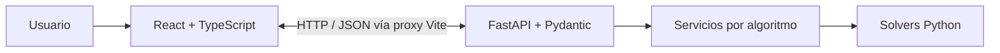

<h1 align="center">IO WEB</h1>
<p align="center"><strong>Simulador interactivo de Programación Dinámica.</strong></p>
<p align="center">Investigación de Operaciones · Tecnológico de Costa Rica · 2026</p>

IO WEB permite ingresar problemas y visualizar tablas y soluciones de cinco algoritmos de Programación Dinámica. Esta técnica reutiliza resultados de subproblemas para calcular probabilidades o encontrar soluciones óptimas. React recoge los datos y presenta las respuestas; Python realiza los cálculos matemáticos.

<p align="center">
  
  
  
  
  
  
</p>

<p align="center">
  
</p>

## Contenido

- [Características y algoritmos](#características-y-algoritmos)
- [Arquitectura y tecnologías](#arquitectura-y-tecnologías)
- [Instalación y ejecución](#instalación-y-ejecución)
- [API](#api)
- [Pruebas y calidad](#pruebas-y-calidad)
- [Flujo Git y GitHub](#flujo-git-y-github)
- [Uso de inteligencia artificial](#uso-de-inteligencia-artificial)
- [Equipo y documentación](#equipo-y-documentación)

## Características y algoritmos

- Formularios por algoritmo, validación de entradas y carga/guardado de configuraciones JSON.
- Tablas, resultados y conclusiones calculados por el backend.
- Revelado progresivo de tablas en Series, ABB y Matrices; la presentación varía por módulo y no constituye un reproductor uniforme de trazas.
- Menú común con indicador de disponibilidad del servidor.
- API REST, pruebas automatizadas y arranque de desarrollo desde una sola terminal.

| Algoritmo | Objetivo | Resultado principal |
| --- | --- | --- |
| Series Deportivas | Calcular la probabilidad de ganar una serie considerando el orden de localías. | Probabilidades de ambos equipos y tabla F. |
| Reemplazo de Equipos | Minimizar el costo de adquisición, mantenimiento y reventa durante un horizonte. | Costo mínimo, tabla G y planes óptimos; la API permite consultar los planes por páginas. |
| Problema de Mochila | Maximizar el valor bajo una capacidad, en variantes 0-1, acotada y no acotada. | Valor óptimo, objetos y cantidades elegidos, tablas de valores y decisiones. |
| Árbol Binario de Búsqueda Óptimo | Minimizar el costo promedio de búsqueda según los pesos de las llaves. | Tablas A y R, costo y raíz; utiliza probabilidades redondeadas a dos decimales según la convención implementada. |
| Multiplicación Óptima de Matrices | Elegir el orden de una cadena de multiplicaciones con menor costo escalar. | Tablas M y P, costo mínimo y parentización óptima. |

## Arquitectura y tecnologías

El monorepositorio separa la interfaz y una API sin base de datos. El cliente envía JSON por HTTP; FastAPI recibe las solicitudes y Pydantic valida entradas y respuestas. En desarrollo, Vite reenvía `/api` a `http://127.0.0.1:8000`.



Cada módulo backend separa `router.py` (HTTP), `schemas.py` (contratos y validación), `service.py` (coordinación y serialización) y `solver.py` (cálculo matemático). React comparte la plantilla de navegación y mantiene formularios y vistas por algoritmo. Las funciones y módulos cuentan con documentación interna.

| Responsabilidad | Herramientas |
| --- | --- |
| Interfaz y navegación | React, TypeScript, React Router, Vite, CSS |
| API y cálculo | Python, FastAPI, Pydantic, Uvicorn |
| Pruebas y calidad | pytest, HTTPX/TestClient, Vitest, Testing Library, jsdom, ESLint, compilador TypeScript |
| Desarrollo y colaboración | Node.js, npm, Git, GitHub, GitHub Actions |

```text
IO_WEB/
├── assets/panel.png
├── backend/
│   ├── app/
│   │   ├── algoritmos/      # Cinco módulos con router, schemas, service y solver
│   │   ├── api/            # Health
│   │   ├── core/           # Configuración CORS
│   │   └── main.py
│   ├── tests/
│   └── README.md
├── frontend/src/
│   ├── componentes/        # Menú, formularios y resultados
│   ├── estilos/
│   ├── pruebas json/       # Archivos de ejemplo y referencias
│   └── tests/
├── scripts/dev.mjs
├── .github/workflows/
├── CONTRIBUTING.md
├── package.json
└── README.md
```

## Instalación y ejecución

### Requisitos

- Git para clonar el repositorio.
- **Node.js 22.12.0 o superior**, con npm, según el lanzador raíz. CI utiliza Node.js 24.
- **Python 3.12 o superior**, disponible como `python` en Windows o `python3` en Linux/macOS.
- Puertos **8000** y **5173** disponibles.

### Preparación inicial

```sh
git clone https://github.com/RaJami1205/IO_WEB.git
cd IO_WEB
npm --prefix frontend ci
```

Desde esa misma raíz, crea el entorno e instala las dependencias Python, incluidas las herramientas de pruebas.

**Windows / PowerShell:**

```powershell
python -m venv backend/.venv
.\backend\.venv\Scripts\python.exe -m pip install -r backend/requirements-dev.txt
```

**Linux / macOS:**

```sh
python3 -m venv backend/.venv
./backend/.venv/bin/python -m pip install -r backend/requirements-dev.txt
```

No es necesario activar el entorno virtual. `requirements-dev.txt` incluye `requirements.txt`; este último basta para ejecutar sin herramientas de pruebas. La raíz no tiene dependencias npm que instalar.

### Un solo comando

Después de la preparación, ejecuta desde la raíz:

```sh
npm run dev
```

El lanzador nativo de Node.js comprueba los entornos y puertos, inicia FastAPI con recarga y espera su health. Luego inicia Vite con puerto estricto, verifica la interfaz y el health a través del proxy y muestra las URLs. No instala dependencias automáticamente.

| Recurso | Dirección local |
| --- | --- |
| Interfaz | [localhost:5173](http://localhost:5173) |
| Dirección base de la API | [127.0.0.1:8000](http://127.0.0.1:8000) |
| Swagger UI | [127.0.0.1:8000/docs](http://127.0.0.1:8000/docs) |
| Health | [127.0.0.1:8000/api/health](http://127.0.0.1:8000/api/health) |

Frontend y backend siguen siendo procesos separados, administrados desde una terminal. **Pulsa Ctrl+C para solicitar el cierre de ambos.** El lanzador supervisa los procesos y la salud del proxy, y cierra los servicios propios ante un fallo. Uvicorn conserva sus mensajes de inicio, advertencias y errores, con el registro de accesos desactivado para evitar ruido por las consultas de salud.

Si un puerto está ocupado, el arranque se rechaza sin cerrar al ocupante. El plazo de disponibilidad es de 30 segundos por servicio. El cierre real con Ctrl+C y el reinicio deben comprobarse en la terminal de destino; no se garantiza la limpieza tras terminar abruptamente el proceso padre. El manejo de grupos y señales de Linux/macOS no se ha validado experimentalmente en esta revisión.

El frontend también puede iniciarse por separado con `npm --prefix frontend run dev`; necesita la API activa para resolver problemas. El arranque independiente de la API se describe en [backend/README.md](backend/README.md).

## API

Con el backend iniciado, [Swagger UI](http://127.0.0.1:8000/docs) permite consultar y probar los contratos actuales; [OpenAPI](http://127.0.0.1:8000/openapi.json) expone sus esquemas.

| Recurso | Método | Endpoint |
| --- | --- | --- |
| Salud | GET | `/api/health` |
| Series Deportivas | POST | `/api/series-deportivas` |
| Reemplazo de Equipos | POST | `/api/reemplazo-equipos` |
| Mochila | POST | `/api/problema-mochila` |
| ABB Óptimo | POST | `/api/abb-optimo` |
| Multiplicación de Matrices | POST | `/api/multiplicacion-matrices` |

Health responde `{"status":"ok"}`. Los solucionadores reciben configuraciones JSON y devuelven resultados y tablas; los detalles adicionales dependen del módulo. Las entradas inválidas se rechazan con HTTP 422. El [README del backend](backend/README.md) contiene ejemplos y convenciones de varios módulos; para el contrato completo vigente, consulta Swagger.

## Pruebas y calidad

**Backend**, desde la raíz:

```powershell
# Windows / PowerShell
cd backend
.\.venv\Scripts\python.exe -m pytest -q
cd ..
```

En Linux/macOS, dentro de `backend/`, utiliza `./.venv/bin/python -m pytest -q`. Las pruebas cubren validación, endpoints, resultados matemáticos, casos límite y, según el módulo, reconstrucción de tablas y comparación con enumeraciones independientes.

**Frontend**, desde la raíz, en cualquiera de los sistemas:

```sh
npm --prefix frontend test
npm --prefix frontend run lint
npm --prefix frontend run build
```

Vitest y Testing Library verifican validaciones y carga de configuraciones en los componentes. ESLint revisa el código; el build comprueba TypeScript y genera la distribución con Vite. Estas comprobaciones se complementan con pruebas manuales de navegación, resolución de ejercicios y cierre/reinicio del lanzador.

## Flujo Git y GitHub

```text
feature/*  ── Pull Request ──>  dev  ── Pull Request ──>  main
```

Las ramas `feature/*` aíslan los cambios; `dev` integra y valida el trabajo conjunto; `main` reúne las versiones consolidadas. La política del equipo establece revisión de código, una aprobación hacia `dev`, dos hacia `main`, checks obligatorios, conversaciones resueltas y rama actualizada cuando se requiera. También establece proteger `dev` y `main` frente a pushes directos y cambios que eludan la revisión.

Los workflows presentes definen:

- **`frontend-quality`**: instalación reproducible, lint, build y pruebas con Node.js 24.
- **`backend-quality`**: instalación, `pip check` y pytest con Python 3.12.
- **`branch-policy`**: admite únicamente PR de `feature/*` a `dev` y de `dev` a `main`.

La presencia de estos workflows confirma las comprobaciones configuradas, no su último resultado ni la activación de protecciones remotas. Las reglas efectivas deben consultarse en GitHub. Véanse [CI](.github/workflows/ci.yml), [política de PR](.github/workflows/pr-policy.yml) y [guía de contribución](CONTRIBUTING.md).

## Uso de inteligencia artificial

Durante el desarrollo se utilizaron **Herramientas de IA** como apoyo en consultas conceptuales y matemáticas, revisión de enfoques de Programación Dinámica, análisis de código, identificación de casos límite, preparación y revisión de pruebas, depuración, integración y documentación. La asistencia abarcó propuestas de implementación y verificación, además de documentación.

El equipo definió los objetivos y requisitos, revisó las implementaciones y mantuvo la responsabilidad sobre las decisiones de diseño, la aceptación y la integración de cambios. Los resultados se contrastaron con ejercicios disponibles y pruebas independientes; las propuestas de IA se evaluaron dentro de ese proceso, sin considerar su generación como evidencia de corrección. Cada integrante conserva la responsabilidad de comprender, explicar y validar el código que presenta.

## Equipo y documentación

Proyecto académico desarrollado por **Raul, Elder y Diego**, según los créditos de la aplicación, para Investigación de Operaciones en el **Tecnológico de Costa Rica**.

- [Repositorio IO WEB](https://github.com/RaJami1205/IO_WEB).
- [Documentación del backend](backend/README.md): instalación independiente, CORS y ejemplos de solicitudes y respuestas.
- [Contribución](CONTRIBUTING.md): flujo de colaboración y responsabilidades de revisión.
- [Archivos JSON de prueba](frontend/src/pruebas%20json): ejemplos de entrada y casos inválidos organizados por problema.

Los documentos de backend y contribución conservan algunas notas históricas de fases iniciales; la estructura, comandos y checks actuales se resumen aquí y se pueden contrastar con el código y los workflows enlazados.
